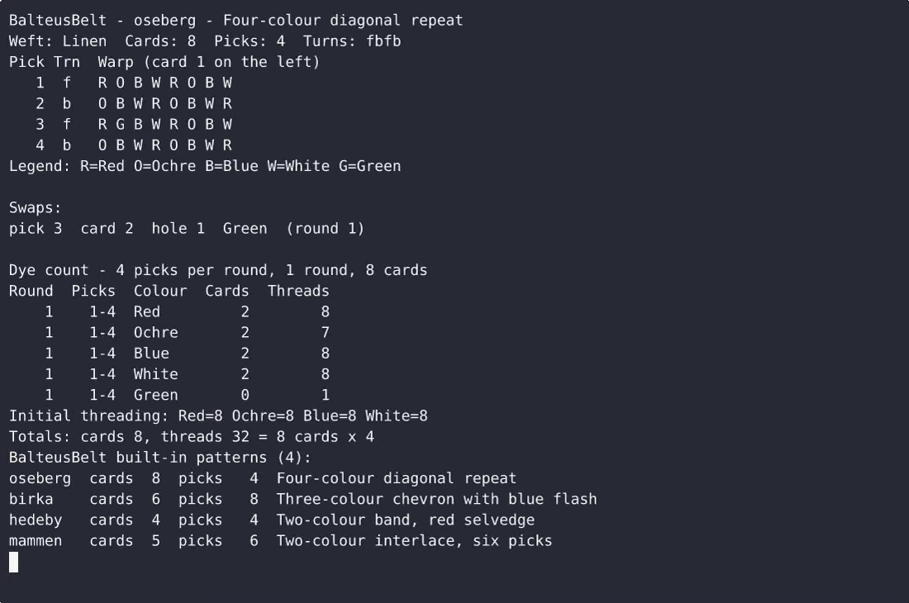
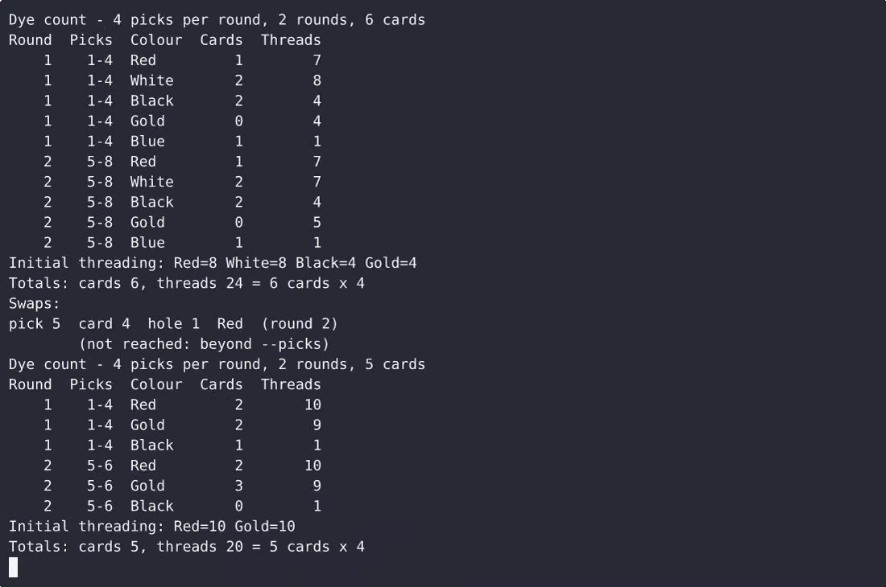

# BalteusBelt — complete Full-stack app command-line tool example app

**BalteusBelt** gives you two paths: self-host the Apache-2.0-licensed Full-stack app source as your own command-line tool, or [open it on cenius.ai](https://cenius.ai/marketplace/p/balteusbelt?ref=gh&utm_campaign=balteusbelt-webapp), describe the changes you want, and receive a new BalteusBelt build with full rebrand rights. BalteusBelt is a single-file, standard-library-only Python CLI that prints a Viking-style tablet-weave pattern: an ASCII grid of picks x cards showing which warp colour faces up, a chronological warp colour swap sched…. Everything ships in this repo — no paywall, no hidden features, no separate BalteusBelt download.


[](LICENSE)  [](https://cenius.ai)

[](https://cenius.ai/marketplace/p/balteusbelt?ref=gh&utm_campaign=balteusbelt-webapp)

> **▶ [Open & edit in cenius.ai](https://cenius.ai/marketplace/p/balteusbelt?ref=gh&utm_campaign=balteusbelt-webapp)** — one click to an editable workspace: describe changes in plain English, get an instant preview, one-click deploy and host. Modifications made on the platform come with full rebrand & relicense rights.

_Local clone? See [Quick start](#quick-start) below. cenius.ai is the zero-setup path._

## Demo


📽 **[Watch the walkthrough](https://cenius.ai/marketplace/p/balteusbelt?ref=gh&utm_campaign=balteusbelt-webapp)** — plays on cenius.ai · [MP4 file](.github/media/demo.mp4)

## Screenshots

 

## Quick start

```bash
./install.sh   # installs dependencies + seeds demo data
```

See [`INSTALL.md`](INSTALL.md) for full setup and usage instructions.

## Features

- Pattern loading from built-ins or a file
- Weave pattern grid render
- Warp colour swap schedule
- Cards-per-round dye count
- Section filter and clean output

## Architecture

Open the repo and you'll find a complete Full-stack app application (24 files). Top-level layout: `examples/`, `tests/`. Starting up is just `./install.sh`: it installs what is needed and pre-fills the database so you have data to work with straight away. Step-by-step setup guide: [`INSTALL.md`](INSTALL.md).

## Usage guide

### Overview

This is **BalteusBelt** — a command-line tool. This document covers the surface area you can use, with copy-pasteable examples for each entry point. For setup, see `INSTALL.md`.

### Quickstart

```bash
this-tool --help
## or, if installed from source without symlink:
python -m BalteusBelt --help
```

### Commands

_No subcommands were auto-extracted. Run `this-tool --help` to see the available commands._

### Worked example

1. Verify the CLI is on your PATH: `which this-tool` (or run via `cargo run --`/`python -m`).
2. Show all subcommands: `this-tool --help`.

### Reference

#### Entry points

_No explicit entry points declared in this project's manifests._

### Next steps

- Read [INSTALL.md](./INSTALL.md) if anything in the Quickstart didn't work.
- Inspect `.env.example` for the full list of environment variables this project understands.
- See [README.md](./README.md) for the architecture diagram + feature list.

_Full guide: [`USAGE.md`](USAGE.md)_

## FAQ

### How do I get BalteusBelt running locally?

Grab the repo and run `./install.sh` — it handles packages and seed data in one go. After that, [`INSTALL.md`](INSTALL.md) walks you through starting the server. No external accounts required.

### Can non-developers customise BalteusBelt?

Open it on [cenius.ai](https://cenius.ai/marketplace/p/balteusbelt?ref=gh&utm_campaign=balteusbelt-webapp) and describe the changes you want in plain English — the platform modifies the app and gives you a new, downloadable build.

### Is it possible to white-label BalteusBelt for a client?

Yes. The MIT license lets you remove the original branding and ship under your own name. For a guided approach, [remix it on cenius.ai](https://cenius.ai/marketplace/p/balteusbelt?ref=gh&utm_campaign=balteusbelt-webapp): you get a fresh build with full rebrand and relicense rights.

### What is BalteusBelt built with?

BalteusBelt is a Full-stack app application — and this repository holds the complete, runnable source, not a stripped-down sample. Highlights include cards-per-round dye count.

### Is it OK to ship BalteusBelt as part of a product?

It is. Apache-2.0 licensing means you can build a product on it, sell it, or use it inside a company with no fees. Details: [LICENSE](LICENSE).

## License & rebranding

Released under the [Apache License 2.0](LICENSE) (© 2026 Cenius AI) — free for personal and commercial use. The Cenius name/logo are trademarks (see NOTICE).

**Need a customized version?** [Remix this app on cenius.ai](https://cenius.ai/marketplace/p/balteusbelt?ref=gh&utm_campaign=balteusbelt-webapp) — modifications made on the platform come with **full rebrand & relicense rights** over your derivative.

## Built with cenius.ai

This entire application — code, design, seeded demo data — was generated on **[cenius.ai](https://cenius.ai)** from a plain-English description.

- 🚀 [Build your own app on cenius.ai](https://cenius.ai)
- 🎛️ [Remix BalteusBelt on the marketplace](https://cenius.ai/marketplace/p/balteusbelt?ref=gh&utm_campaign=balteusbelt-webapp) — open it in a workspace, prompt for changes, and ship your own version.

More open-source apps: [the Cenius-ai catalog](https://github.com/Cenius-ai) · [showcase index](https://github.com/Cenius-ai/showcase)
